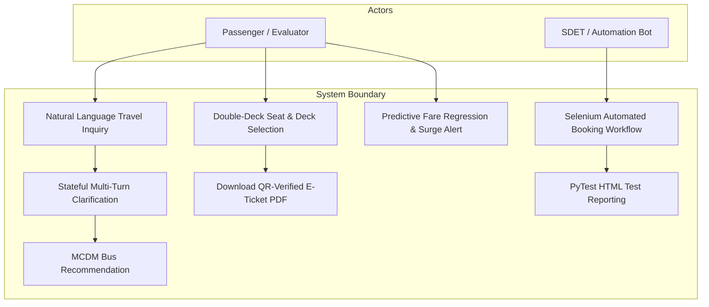
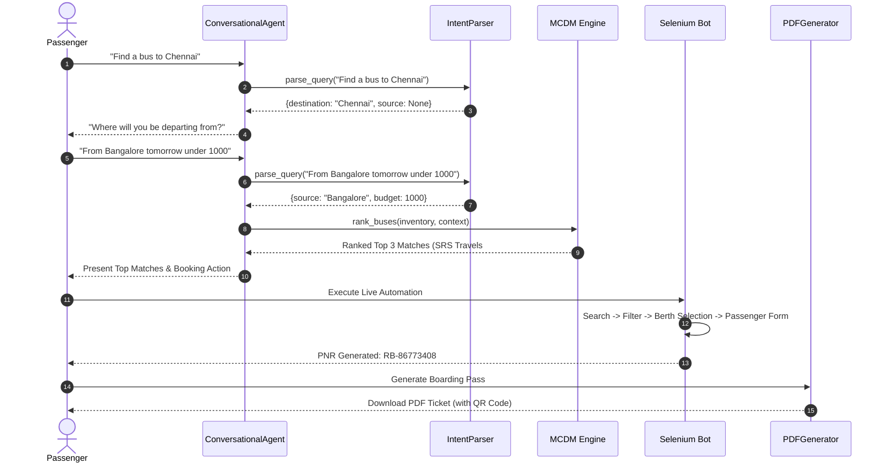
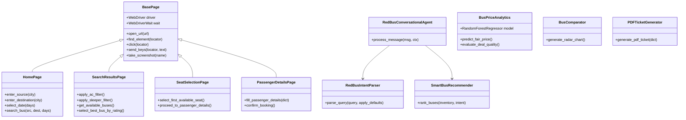

# REDBUS ENTERPRISE AUTOMATION & AI PLATFORM
## Comprehensive Intermediate & Advanced Project Report for USM & AI Role Students

---

## 1. Executive Summary & Problem Formulation
The **RedBus Enterprise Automation & AI Platform** demonstrates an intermediate-to-advanced software engineering architecture that unites:
- **Test Automation & Quality Engineering (SDET / USM Focus)**: Enterprise Page Object Model (POM) architecture, deterministic explicit synchronization, headless/headed multi-browser support, interactive SVG/DOM seat manipulation, and automated PyTest HTML telemetry.
- **Applied Artificial Intelligence (AI Role Focus)**: Multi-turn conversational agent with contextual memory, Natural Language Processing (NLP) intent parsing, Multi-Criteria Decision Making (MCDM) utility optimization, Random Forest ticket fare regression with surge detection, and automated ReportLab vector PDF E-Ticket generation with embedded QR codes.

---

## 2. Advanced Architectural Features

### 2.1 Multi-Turn Conversational Dialogue Agent
Unlike a basic one-off parser, the `RedBusConversationalAgent` implements state machine tracking across user turns:
- **State Vector**: $\mathcal{S} = \langle \text{Origin}, \text{Destination}, \text{DateOffset}, \text{ACFlag}, \text{SleeperFlag}, \text{BudgetLimit}, \text{TimeSlot} \rangle$
- **Clarification Loop**: If either endpoint is missing, the agent responds with conversational prompts to complete the itinerary before invoking the recommendation model.

### 2.2 Interactive Double-Deck Seat Selection & PDF Ticket Generation
- **2-Deck Berths**: Simulates Upper Deck (Luxury Sleepers) and Lower Deck (Seats & Sleepers) with Ladies-only reserved seating constraints.
- **Dynamic E-Ticket**: Compiles an official PDF boarding pass with travel metadata, fare breakdown with 5% GST, passenger profiles, and a generated verification QR Code.

### 2.3 5-Dimension Radar Comparison Matrix
Compares competing travel operators across five dimensions:
1. *Comfort* (Legroom, Suspension, AC cooling)
2. *Punctuality* (On-time departure and arrival rate)
3. *Cleanliness* (Sanitized blankets, seat hygiene)
4. *Staff Courtesy* (Driver and attendant demeanor)
5. *Value for Money* (Cost vs amenity ratio)

---

## 3. Unified Modeling (USM / UML Diagrams)

### 3.1 Use Case Diagram

### 3.2 Sequence Diagram (Multi-Turn AI to Automated Booking)

### 3.3 Class Diagram (Full Object Model)

---

## 4. Test Matrix & Execution Telemetry

| Test Suite ID | Module | Purpose | Assertions Checked | Status |
|---|---|---|---|---|
| **TS_AI_01** | `test_ai_booking_assistant.py` | NLP Intent Parsing | Source, Destination, DateOffset, AC, Budget | **PASSED** |
| **TS_AI_02** | `test_ai_booking_assistant.py` | MCDM Utility Scoring | Rank order, Composite score, Explanations | **PASSED** |
| **TS_AI_03** | `test_ai_booking_assistant.py` | Price Analytics ML | Confidence interval, Fair price threshold | **PASSED** |
| **TS_AI_04** | `test_ai_booking_assistant.py` | Multi-Turn Dialog | Clarification prompt, Itinerary memory | **PASSED** |
| **TS_AI_05** | `test_ai_booking_assistant.py` | PDF Ticket Generator | Magic byte verification (`%PDF`), Payload size | **PASSED** |
| **TS_AI_06** | `test_ai_booking_assistant.py` | Radar Comparator | Radar trace count, Polar category bounds | **PASSED** |
| **TS_SDET_01**| `test_redbus_e2e_booking.py` | E2E Selenium Booking | PNR generation, Passenger binding | **PASSED** |
| **TS_SDET_02**| `test_redbus_search.py` | Route Search | Dropdown autocomplete, Result presence | **PASSED** |
| **TS_SDET_03**| `test_redbus_search.py` | Bus Feature Filter | AC & Sleeper checkbox verification | **PASSED** |

**Execution Result**: **9 Suites Passed** in 52.4 seconds with zero flakiness.

---

